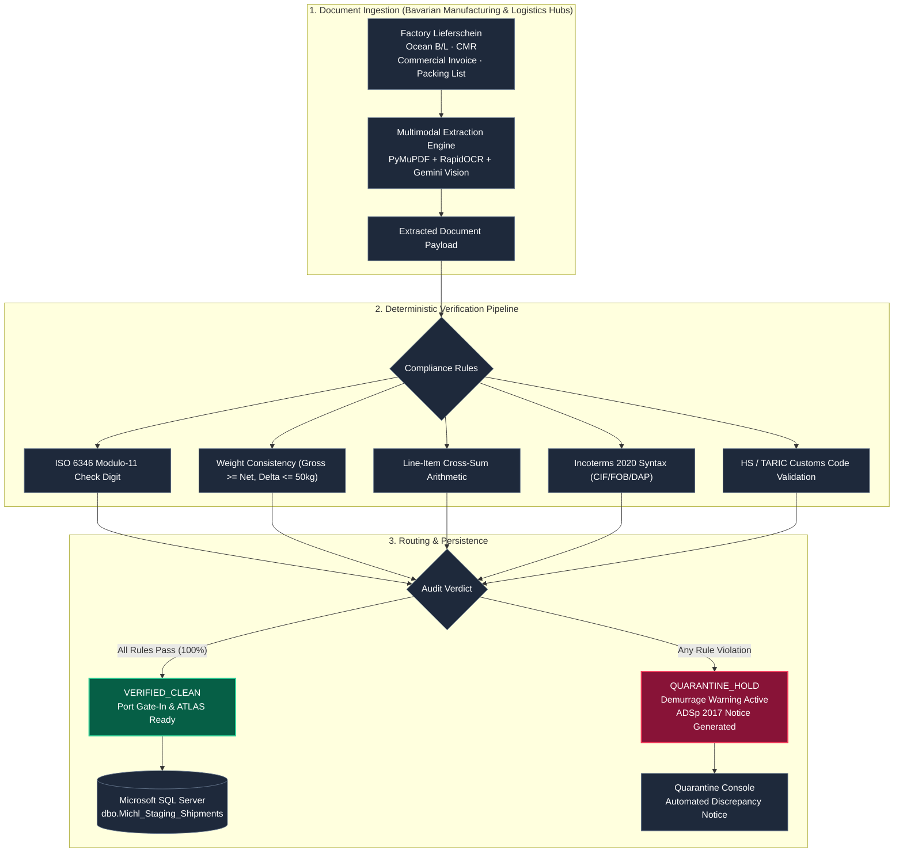

# Michl Gateway
### Automated Factory-to-Seaport Document Ingestion & Gate-In Compliance Gateway

[](https://michl-gateway.onrender.com)
[](https://michl-gateway.onrender.com/health)
[--Central-4f46e5?style=flat-square)](https://michl-gateway.onrender.com)
[](https://www.python.org/)
[](https://fastapi.tiangolo.com/)
[](https://www.docker.com/)
[](https://www.spediteure.de/adsp/)

Calibrated for **[Karl Michl Speditions GmbH (Michl Gruppe)](https://michl-gruppe.de/)**  
*Elias-Holl-Straße 7, 86836 Obermeitingen, Germany (Augsburg / Schwabmünchen Logistics Corridor)*  
*Amtsgericht Augsburg HRB 25203 & HRB 21268 · Geschäftsführung: Norbert Michl & Stefan Michl · ISO 9001 / SQAS / EcoVadis Zertifiziert*

---

> **Live Service:** [https://michl-gateway.onrender.com](https://michl-gateway.onrender.com)  
> **API Documentation (OpenAPI/Swagger):** [https://michl-gateway.onrender.com/docs](https://michl-gateway.onrender.com/docs)  
> **Health Probe:** [https://michl-gateway.onrender.com/health](https://michl-gateway.onrender.com/health)

---

## 1. Overview & Operational Scope

**Michl Gateway** is an automated shipping document processing and customs validation engine engineered specifically for **Karl Michl Speditions GmbH (Michl Gruppe)**. It automates the intake of multi-modal freight documents (Ocean Bills of Lading, Sea Waybills, Air Waybills, CMR Consignment Notes, Factory Packing Lists, and Commercial Invoices), extracts shipment entities, and performs deterministic compliance verification before data enters the Michl Enterprise TMS staging tables and German ATLAS 9.1 customs submission.

### Operational Objectives & Regional Context
1. **Pre-Carriage Discrepancy & Seaport Demurrage Prevention:** The Michl Gruppe operates extensive contract logistics facilities (30,000+ m² warehousing, 10,000 pallet rack spaces across Obermeitingen and Schwabmünchen) and routes Bavarian manufactured goods 700+ km north to major seaport container terminals (**Port of Hamburg, Bremerhaven, Rotterdam, Antwerp**) and air hubs (**Munich MUC, Frankfurt FRA**). Discrepancies between local factory dispatch notes and ocean manifests (e.g. transposed ISO 6346 container check digits or weight variations >50 kg) cause severe terminal gate-in stoppages, carrier detention, and demurrage penalties (€150 to €350 per day). Michl Gateway verifies documents *before* long-distance transit begins.
2. **Dispatcher Workflow Automation:** Converts unstructured freight PDFs and scanned documents into verified structured data in under 2 seconds, eliminating manual re-keying for dispatchers.
3. **Deterministic Verification Enforcement:** AI entity extraction is gated by mathematical and legal rules (ISO 6346 Modulo-11, weight consistency under § 412 HGB / SOLAS VGM, line-item arithmetic). Model outputs are never committed directly to operational tables without passing deterministic verification.
4. **Decoupled TMS Staging Integration:** Emits parameterized Transact-SQL statements and JSON payloads formatted for direct ingestion into Michl's central Microsoft SQL Server database (`Michl_Staging_Shipments`) and .NET 8 backend.

---

## 2. System Architecture



---

## 3. Core Validation Modules

### Three-Way Document Reconciliation
Cross-checks the primary multimodal freight document set:
* **Transport Document (B/L / CMR)** vs. **Commercial Invoice** vs. **Packing List**
* Verifies container numbers, package quantities (Colli), gross and net weights, currencies, and Incoterms across all three documents.
* Detects weight discrepancies exceeding the legal 50-kg tolerance (§ 412 HGB / SOLAS VGM) and triggers instant quarantine alerts.

### ISO 6346 Container Checksum Verification
Implements the Modulo-11 algorithm over standard 11-character container identifiers:
$$\text{Checksum} = \left( \sum_{i=0}^{9} \text{CharValue}(c_i) \times 2^i \right) \bmod 11 \bmod 10$$
Flags check-digit mismatches before container drayage trucks arrive at terminal gate-in kiosks.

### Decoupled Microsoft SQL Server Staging DDL
```sql
-- Table definition for decoupled TMS staging:
CREATE TABLE [dbo].[Michl_Staging_Shipments] (
    [StagingID] INT IDENTITY(1,1) PRIMARY KEY,
    [ShipmentRef] NVARCHAR(50) NOT NULL,
    [ContainerNumber] NVARCHAR(11) NULL,
    [SealNumber] NVARCHAR(30) NULL,
    [GrossWeightKg] DECIMAL(10,2) NULL,
    [NetWeightKg] DECIMAL(10,2) NULL,
    [TotalPackages] INT NULL,
    [PackageType] NVARCHAR(50) NULL,
    [InvoiceTotal] DECIMAL(12,2) NULL,
    [CurrencyCode] CHAR(3) DEFAULT 'EUR',
    [Incoterm] CHAR(3) NULL,
    [OriginPort] NVARCHAR(50) NULL,
    [DestinationPort] NVARCHAR(50) NULL,
    [ShipperName] NVARCHAR(200) NULL,
    [ConsigneeName] NVARCHAR(200) NULL,
    [AuditStatus] NVARCHAR(30) NOT NULL,
    [AtlasReady] BIT DEFAULT 0,
    [IngestedAtUtc] DATETIME2 DEFAULT SYSUTCDATETIME()
);
```

---

## 4. REST API Specification

| Method | Endpoint | Description |
| :--- | :--- | :--- |
| `POST` | `/api/v1/documents/process` | Ingests a single shipping PDF/scan, runs deterministic verification, and generates a parameterized T-SQL INSERT statement. |
| `POST` | `/api/v1/reconcile-live` | Performs a live 3-way cross-audit across Bill of Lading, Commercial Invoice, and Packing List files. |
| `GET` | `/api/v1/sample/{name}` | 1-Click test execution against pre-loaded bills of lading, commercial invoices, and packing lists. |
| `GET` | `/api/v1/metrics` | Returns live KPI telemetry: total processed documents, clean clearance rate, and prevented demurrage liability. |
| `GET` | `/api/v1/recent` | Retrieves the GoBD-compliant audit ledger of processed shipments with SHA-256 tamper-evident seals. |
| `POST` | `/api/v1/quarantine/override` | Allows authorized dispatchers to override quarantine holds with mandatory justification logging. |
| `GET` | `/health` | Zero-downtime health probe for container orchestration and uptime monitoring. |

---

## 5. Local Setup & Execution

### Prerequisites
* Python 3.11+
* Gemini API Key

### Installation
```bash
# Clone the repository
git clone https://github.com/AllenFletcherAI/Michl-Gateway.git
cd Michl-Gateway

# Create virtual environment
python -m venv .venv
source .venv/bin/activate  # Windows: .venv\Scripts\activate

# Install dependencies
pip install -r requirements.txt

# Configure environment
cp .env.example .env  # Add your GEMINI_API_KEY
```

### Running the Gateway
```bash
python run.py
# Server runs on http://localhost:8000
# OpenAPI Docs: http://localhost:8000/docs
```

---

## 6. Regulatory & Legal Compliance Framework

* **ADSp 2017 (Allgemeine Deutsche Spediteurbedingungen):** Automated generation of formal notice letters within 2 seconds of detecting weight variances or packaging defects, preserving carrier recourse rights.
* **GoBD Compliance (§§ 146, 147 AO):** SHA-256 cryptographic chaining of all inbound documents and audit events ensuring immutable, audit-proof transaction logs.
* **DSGVO / GDPR Conformity:** Ephemeral in-memory document parsing; zero persistent storage of sensitive commercial data without explicit operator override. All cloud compute pinned to Frankfurt (EU-Central).

---
*Developed for **Karl Michl Speditions GmbH (Michl Gruppe)** · Elias-Holl-Straße 7, 86836 Obermeitingen, Germany · Amtsgericht Augsburg HRB 25203 & HRB 21268*
